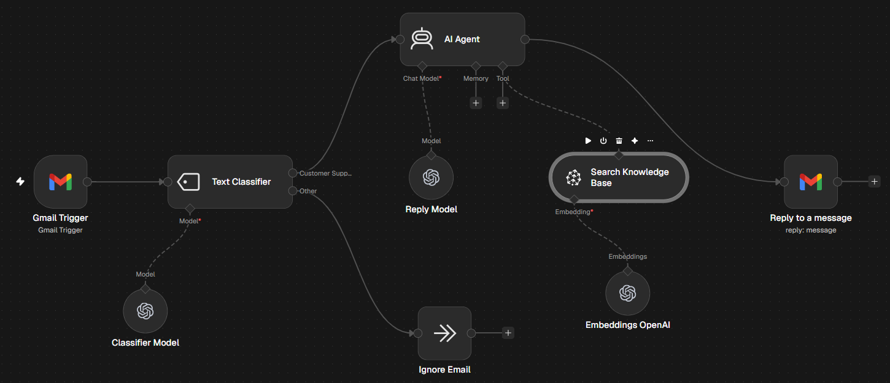

# AI Customer Support Email Agent

Monitors Gmail, classifies incoming emails with AI, and replies to support questions using answers retrieved from a Pinecone knowledge base.

## How it works

New email in Gmail → AI Text Classifier → support emails go to AI Agent with Pinecone knowledge base → reply in the same thread (other emails are ignored)

## Tools used

Gmail, Pinecone, OpenAI

## Setup

1. Import `workflow.json` into n8n (**Workflows → Import from File**).
2. Connect your own credentials in each node.
- Uses the same Pinecone index as the RAG Pipeline workflow to fill the knowledge base.
