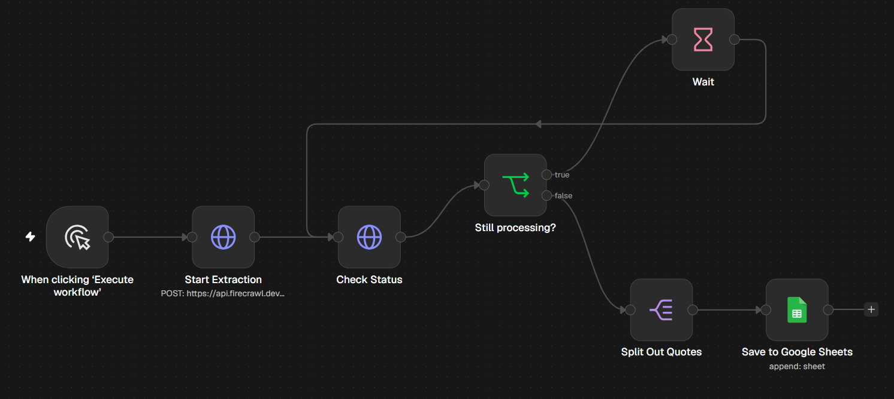

# Web Scraper with Firecrawl

Extracts structured data from websites using Firecrawl's AI extraction API, polling until results are ready and saving them to Google Sheets.

## How it works

Start extraction job → check job status → if still processing, wait 5 seconds and check again → when complete, split results into rows → save to Google Sheets

## Tools used

Firecrawl API, Google Sheets

## Setup

1. Import `workflow.json` into n8n (**Workflows → Import from File**).
2. Connect your own credentials in each node.
- Add your Firecrawl API key as a Header Auth credential (`Authorization: Bearer <key>`).
- Replace `YOUR_GOOGLE_SHEET_ID` with a sheet that has the columns Quote, Author, Tags.
