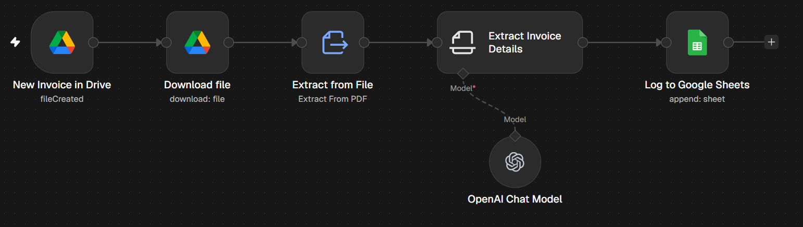

# Invoice Data Extractor

Detects new PDF invoices in Google Drive, extracts company, invoice number, dates and total amount with AI, and logs them to Google Sheets.

## How it works

New PDF in Drive folder → download → extract text → AI Information Extractor → append row to Sheets

## Tools used

Google Drive, Google Sheets, OpenAI

## Setup

1. Import `workflow.json` into n8n (**Workflows → Import from File**).
2. Connect your own credentials in each node.
- Replace `YOUR_DRIVE_FOLDER_ID` and `YOUR_GOOGLE_SHEET_ID` (sheet columns: Company Name, Invoice Number, Invoice Date, Due date, Total Amount).
