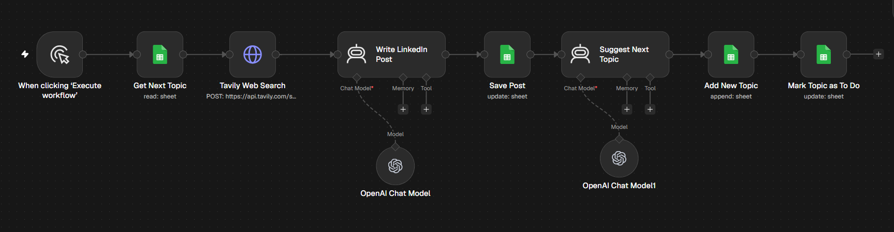

# LinkedIn Content Creator

Pulls a topic from Google Sheets, researches it with Tavily web search, writes a LinkedIn post with an AI agent, and generates the next topic so the content queue refills itself.

## How it works

Get "To Do" topic from Sheets → Tavily web search (past week) → AI Agent writes post → save post to Sheets → AI Agent suggests next topic → add it as "To Do"

## Tools used

Google Sheets, Tavily API, OpenAI

## Setup

1. Import `workflow.json` into n8n (**Workflows → Import from File**).
2. Connect your own credentials in each node.
- Replace `YOUR_GOOGLE_SHEET_ID` with a sheet that has the columns Topic, Status, Content.
- Add your Tavily API key as a Header Auth credential.
