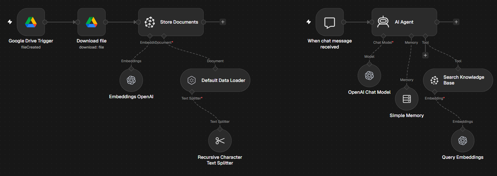

# RAG Pipeline & Chatbot

Watches a Google Drive folder, splits and embeds new documents into Pinecone, and serves a chatbot that answers questions from that knowledge base.

## How it works

Ingestion: new file in Drive → download → split into chunks → embed (OpenAI) → store in Pinecone
Chat: chat message → AI Agent → retrieves relevant chunks from Pinecone → answer (with conversation memory for follow-up questions)

## Tools used

Google Drive, Pinecone, OpenAI (chat + embeddings)

## Setup

1. Import `workflow.json` into n8n (**Workflows → Import from File**).
2. Connect your own credentials in each node.
- Replace `YOUR_DRIVE_FOLDER_ID` with the folder to watch.
- Create a Pinecone index with 512 dimensions.
