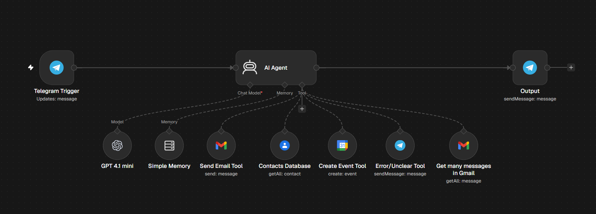

# AI Personal Assistant (Telegram)

Telegram-based AI agent that sends and reads Gmail, looks up Google Contacts, and creates Google Calendar events from plain-language messages, asking for clarification when a request is unclear.

## How it works

Telegram message → AI Agent (GPT-4.1 mini) with tools: Send Email, Read Emails, Contacts lookup, Create Calendar Event, Ask for Clarification → reply on Telegram

Conversation memory is kept per chat, so the agent can follow up on its own clarifying questions.

## Tools used

Telegram bot, Gmail, Google Contacts, Google Calendar, OpenAI

## Setup

1. Import `workflow.json` into n8n (**Workflows → Import from File**).
2. Connect your own credentials in each node.
- Replace `YOUR_TELEGRAM_USER_ID` with your Telegram user ID (only this user can trigger the bot).
- Select your own calendar in the Create Event tool.
