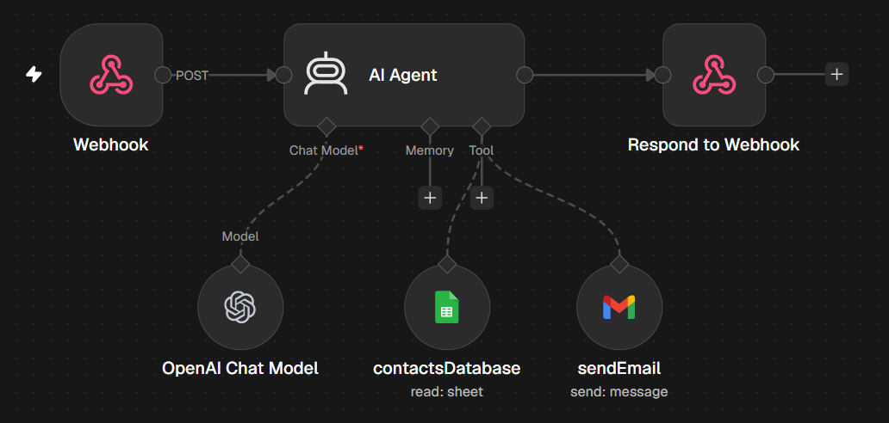

# Voice Email Agent

Webhook-triggered agent that turns voice instructions into finished emails, finding recipients in a Google Sheets contact list and sending through Gmail.

## How it works

Voice agent sends recipient + message to webhook → AI Agent looks up the email address in Sheets → writes and sends the email via Gmail → responds to the webhook

## Tools used

Webhook, Google Sheets, Gmail, OpenAI

## Setup

1. Import `workflow.json` into n8n (**Workflows → Import from File**).
2. Connect your own credentials in each node.
- Replace `YOUR_GOOGLE_SHEET_ID` with a contacts sheet (name, email).
- The webhook uses Header Auth: create a Header Auth credential and send the same header from your voice agent.
- The workflow must be active for the voice agent to reach the webhook.
